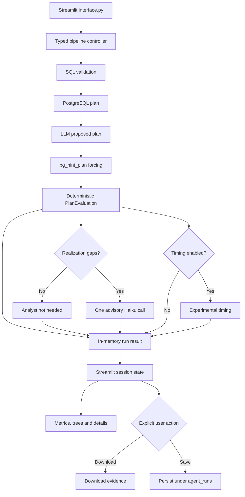

# Streamlit GUI Scope and Implementation Plan

- Status: scope draft for reviewer feedback
- Implementation status: not started
- Proposed implementation branch dependency: merged comparison metrics and the planned experiment/analyst work

## 1. Purpose

Build a Streamlit interface that lets an examiner provide a read-only SQL query, obtain PostgreSQL and LLM-generated plans, attempt to realize the LLM plan with `pg_hint_plan`, and understand the result through plan trees, deterministic metrics, forcing evidence, and conditional advisory analysis.

The interface must remain usable for queries outside the supplied benchmark templates. Preset queries are conveniences, not restrictions.

## 2. Confirmed product decisions

- The GUI uses Streamlit.
- `python project.py` is the examiner-friendly launch command.
- The existing terminal workflow remains available as `python project.py --cli`.
- The primary input is a free-form SQL editor.
- Seven example queries can populate the editor: five TPC-H queries and two independently handwritten complex queries.
- Queries are validated before the LLM, forcing, timing, or other expensive work begins.
- Connection settings and schema selection are available in a collapsible sidebar, and the selected schema scopes every catalog query and pipeline stage.
- Plans are rendered with Graphviz.
- The three plans are presented through focused pairwise views rather than three cramped trees at once.
- The latest successful result is retained in Streamlit session state.
- Haiku runs automatically only when deterministic analysis finds one or more realization gaps.
- Haiku output is advisory and never changes deterministic metrics.
- Timing is opt-in, disabled by default, and displayed as experimental evidence rather than a structural metric.
- GUI runs stay in memory by default; downloading evidence and saving it under `agent_runs/` are explicit actions.
- The GUI does not fetch arbitrary SQL result rows; its results are plans, comparisons, metrics, forcing evidence, timing when requested, and advisory analysis.
- The planner and analyst model names and their distinct roles are displayed and acknowledged.
- Complete launch instructions must appear in `README.md`, and concise usage instructions must also appear inside the Streamlit site.

## 3. Goals and success criteria

The GUI is successful when a first-time examiner can:

1. Start the application from the repository with `python project.py`.
2. Connect to a PostgreSQL database without editing source code.
3. Select a schema and either enter SQL or load an example.
4. Receive a clear validation error without invoking the LLM when the query is invalid or unsafe.
5. Run the complete planning and comparison pipeline for a valid query.
6. Distinguish the PostgreSQL plan, LLM proposal, and realized executable plan.
7. Understand the three primary metrics and supporting intended-difference metric, including `N/A` and unavailable results.
8. Inspect the exact decisions that matched, differed, or could not be realized.
9. Understand whether an explanation is deterministic or an advisory Haiku suggestion.
10. See which LLM produced the planner output and which produced advisory analysis.
11. Recover from a failed run without losing or mistaking the previous successful result for the latest attempt.

## 4. Scope

### 4.1 MVP

- One query comparison at a time.
- Connection configuration and connection testing.
- Live schema discovery, with catalog facts and planning isolated to the selected schema.
- Free-form, read-only SQL input.
- Seven presets that load editable SQL into the editor.
- Query validation and rewritten-query preview.
- PostgreSQL, proposed-agent, and realized-plan presentation.
- Three primary metric cards plus one clearly labelled supporting metric, all with raw fractions and status explanations.
- Graphviz plan trees and a non-visual decision-details table.
- Deterministic textual explanations for every proposed and realized difference.
- Forcing hints, selected retry settings, reproduced decisions, and realization gaps.
- Automatic Haiku analysis when realization gaps exist.
- Optional experimental timing, disabled by default and isolated from deterministic results.
- In-app instructions and status/progress messages.
- Session-scoped result retention.
- Explicit download and save actions for run evidence; no silent persistence of ad-hoc GUI queries.
- A cross-schema integration fixture that proves the pipeline does not confuse same-named tables in different schemas.
- README setup, launch, CLI, troubleshooting, and database requirements.

### 4.2 Submission boundary

**The MVP above is the submission target for the GUI. Completing the items in the later-enhancements section is not required before submission.** Those items are a future-work backlog, not commitments in the first GUI OpenSpec change, and they should not receive implementation tasks in that change.

The overall project still needs workload-level metric results for the report. The experiment runner provides those results without requiring a workload dashboard in Streamlit. Likewise, the GUI demonstrates schema independence through free-form input, schema-scoped catalog handling, and cross-schema integration tests; it does not need to bundle a full second dataset to satisfy the MVP scope.

A later enhancement should be promoted into a separate OpenSpec change only after:

1. The GUI MVP is implemented and passes its tests.
2. The complete README procedure works from a clean environment.
3. Reviewer feedback does not identify an MVP blocker.
4. The team agrees that the enhancement is worth the remaining time and risk.

If time permits, the preferred follow-up order is controlled repeated timing, workload/aggregate dashboard, run-history browser, a full second dataset, and interactive graph selection.

### 4.3 Optional post-MVP enhancements

The following items are explicitly optional and may remain documented as future work at submission:

- Multi-query workload and experiment dashboard.
- Aggregated macro and micro metrics across saved runs.
- Run-history browsing and comparison.
- A controlled performance panel using alternating execution order, repeated samples, and medians.
- Optional bundled demonstration using a full second dataset such as IMDB.
- Interactive tree-node selection if Graphviz proves too limited.

### 4.4 Non-goals for the MVP

- A general PostgreSQL administration console.
- Editing data or executing write statements.
- Concurrent multi-user run management.
- Treating advisory Haiku output as ground truth.
- Claiming cross-dataset empirical generalizability when only TPC-H has been tested.
- Automatically choosing the "better" plan from execution time alone.
- Fetching or displaying arbitrary SQL result rows.

## 5. End-to-end user journey

1. The user starts the application with `python project.py`.
2. The initial page displays a short **How to use** guide and database prerequisites.
3. The user enters connection details, tests the connection, and selects a schema.
4. The user chooses an example or writes a query in the SQL editor.
5. The user presses **Compare plans**.
6. The application performs local SQL safety and shape validation.
7. PostgreSQL performs a read-only `EXPLAIN` preflight to catch syntax, table, column, and type errors.
8. If validation fails, the application stops before calling the planner LLM and shows an actionable error beside the editor.
9. If validation passes, the application obtains the PostgreSQL plan, asks the planner LLM for a proposal, applies hints, and evaluates the three plans.
10. Deterministic metrics, trees, and textual difference explanations are displayed first.
11. If realization gaps exist, Haiku is called once with all gaps and its advisory assessments are added to the forcing-details view.
12. If the user enabled experimental timing, timing runs separately and any timing failure leaves the deterministic result intact.
13. The user can inspect results, amend the query, rerun, download the evidence, or explicitly save it under `agent_runs/`.

## 6. Application structure

### 6.1 File responsibilities

| File or area | Responsibility |
| --- | --- |
| `project.py` | Stable application entry point, supported Streamlit launcher, retained `--cli` entry point, and typed in-memory pipeline controller. |
| `interface.py` | Streamlit layout and rendering only; it must not contain plan-comparison algorithms. |
| `preprocessing.py` | Existing query normalization, schema description, PostgreSQL plan extraction, and planner-agent interaction. |
| `comparison.py` | Existing forcing, deterministic comparison, and metric computation. |
| `experiments.py` | Validated run model, experiment persistence, timing helper, and advisory analyst support after the experiment change is merged. It must not force GUI runs to time or persist automatically. |
| `docs/` | Metric definitions, limitations, and this GUI scope. |
| `README.md` | Complete setup and run instructions for an examiner. |

The controller in `project.py` should return one typed in-memory run result containing the original and rewritten SQL, model identities, all available plan roots, the `PlanEvaluation`, analyst status, and optional timing. It must not print, prompt, time, or persist unless requested by an explicit option. The experiment runner may wrap this controller and add mandatory persistence for experiment workloads.

The UI should consume typed in-memory objects such as `PlanNode`, `PlanEvaluation`, and the experiment run record. It should not require a manual `to_dict()` layer merely to render results. Serialization is needed only at the download or persistence boundary.

## 7. Page and component inventory

### 7.1 Sidebar

- **Connection** expander
  - Host
  - Port
  - Database
  - Username
  - Password, masked and session-only
  - **Test connection** button
- **Schema** selector populated after a successful connection
- **Settings** expander for timeouts, an **Enable experimental timing** toggle that is off by default, and optional advanced settings
- **How to use** expander with the four-step workflow
- Short legend distinguishing deterministic metrics from advisory analysis
- **AI usage** expander naming the planner and analyst models and explaining their separate roles

The Anthropic API key is read from the environment and is never entered into or displayed by the GUI.

### 7.2 Query panel

- Example selector grouped as **Benchmark** and **Custom**
- SQL text editor
- **Reset example** action
- **Compare plans** primary action
- Validation message area
- Rewritten SQL preview when alias normalization changes the query
- Clear warning that only a single read-only query is accepted

Selecting an example populates the editor but does not lock it. The SQL remains fully editable.

### 7.3 Progress panel

Show the current stage without exposing secrets or the full analyst prompt:

1. Validating SQL
2. Connecting and reading schema
3. Obtaining PostgreSQL plan
4. Asking planner agent
5. Attempting plan realization
6. Computing deterministic metrics
7. Requesting analyst explanation, only if needed
8. Measuring experimental performance, only if enabled
9. Complete

The compare button must be guarded so an ordinary Streamlit rerun or double-click does not submit the LLM request twice.

### 7.4 Result overview

- Query/run status
- Agent strategy summary
- Three primary metric cards and one supporting metric card
- Plain-language metric definitions
- Status banner for forcing and analyst availability
- Planner and analyst model identities
- Links or tabs leading to detailed evidence

The three primary metrics and one supporting metric are:

| Role | Metric | Question answered |
| --- | --- | --- |
| Primary | Proposed-plan difference | How different was the LLM's proposed strategy from PostgreSQL's original strategy? |
| Primary | Plan realizability | How many force-eligible LLM decisions appeared in the realized executable plan? |
| Primary | Realized-plan difference | How different was the realized executable plan from PostgreSQL's original plan? |
| Supporting | Intended-difference realization | Of the force-eligible decisions where the LLM intentionally disagreed with PostgreSQL, how many survived realization? |

Every metric displays its numerator, denominator, percentage when defined, status, and explanation. `N/A` and unavailable values must never be rendered as zero.

### 7.5 Results tabs

#### Overview

- Metric cards
- Agent strategy
- High-level forcing outcome
- Analyst status

#### PostgreSQL vs proposed

- PostgreSQL plan tree
- Agent-proposed plan tree
- All-decision and core-decision summaries
- Per-kind comparison
- Detailed matches and differences
- One deterministic textual explanation for every difference

#### PostgreSQL vs realized

- PostgreSQL plan tree
- Realized executable plan tree
- All-decision and core-decision summaries
- Per-kind comparison
- Detailed matches and differences
- One deterministic textual explanation for every difference

#### Forcing and realizability

- Generated `pg_hint_plan` hints
- Selected forcing configuration
- Force-eligible requested decisions
- Reproduced decisions
- Extra realized decisions
- Realization gaps
- Haiku assessment for each gap when available

#### Technical details

- Original SQL
- Rewritten SQL
- Planner and analyst model names and roles
- Planner attempt count and validation feedback
- Expandable structured plan details
- Run provenance when available
- Download evidence and explicit **Save to agent_runs** actions

Deterministic explanations describe observable facts, not unproven causes. For example:

> For `scan(orders)`, PostgreSQL selected `Seq Scan` while the agent proposed `Index Scan`.

Possible causes are shown only in the separately labelled advisory analysis for realization gaps.

## 8. Plan-tree visualization

Use Graphviz for the first implementation.

Each node should include only the most useful fields by default:

- Node/operator type
- Relation and alias for scans
- Index name when relevant
- Join type when relevant
- Parent relationship or subplan name when relevant

Additional fields can appear in an adjacent detail expander to keep large trees readable.

### 8.1 Visual states

- Green marker: corresponding decision matches
- Orange/red marker: decision differs
- Grey marker: missing, unavailable, or not comparable

Colour must not be the only signal. Every state also needs a text label, icon, border style, or matching decision-table row. A visible legend is required.

One plan node may carry several decisions, such as scan method, index choice, and parallelism, and those decisions may have different statuses. A single node fill colour is therefore insufficient. Each node label should contain per-decision status markers, while its border may summarize the highest-priority status: different, unavailable, then matching.

`st.graphviz_chart` is a display component rather than a selectable graph widget. Interactive node selection is not part of the MVP. Every chart must provide concise alternative text, and the decision table remains the complete non-visual representation.

The current comparison model identifies decisions by semantic keys such as relation aliases and join relation sets, not persistent tree-node IDs. The implementation must create deterministic display IDs and document any cases where a decision cannot be mapped unambiguously to one visual node.

## 9. Example queries

The selector contains seven examples.

### 9.1 TPC-H benchmark examples

- Q1: simpler scan and aggregation example
- Q6: simpler selective scan and aggregation example
- Q5: complex multi-join example
- Q9: complex joins, aggregation, and derived-value example
- Q18: complex subquery, grouping, and join example

### 9.2 Handwritten examples

The custom queries must not be copied or lightly modified benchmark queries.

- **Custom A — customer purchasing concentration:** multiple joins, more than one CTE, grouped aggregation, and a window ranking operation.
- **Custom B — supplier delivery risk:** multiple joins, conditional aggregation, and a correlated `EXISTS`/`NOT EXISTS` pattern that can produce semi-join or anti-join planning choices.

Both run against the available TPC-H data so the examiner needs no second dataset. They demonstrate support for novel query shapes, not empirical cross-dataset generalizability.

Each example should live in its own version-controlled `.sql` file. A small metadata mapping should give every file a stable ID, title, description, complexity label, and source label (`TPC-H` or `Handwritten`). The seven GUI presets are demonstration inputs, not the complete workload used in the final evaluation report.

## 10. Query validation and safety

Validation must happen before any planner-agent request.

### 10.1 Local validation

- Reject an empty editor.
- Parse the complete input with the existing SQL tooling rather than validating only the first expression.
- Require exactly one statement.
- Allow only a read-only query shape such as `SELECT`, `WITH`, set operations, or their supported equivalents.
- Inspect the complete syntax tree and reject DDL, DML, data-modifying CTEs, transaction control, `COPY`, and multiple statements wherever they appear.
- Apply unique-alias rewriting and show the rewritten SQL when it differs.

### 10.2 PostgreSQL preflight

- Use a read-only connection.
- Apply the selected schema through a safely quoted `search_path` or fully qualified internal operation for the entire run.
- Pass the selected schema into database-description and catalog queries, filter by namespace rather than only relation name, and handle schema-qualified SQL consistently.
- Run non-executing `EXPLAIN` to validate referenced relations, columns, functions, and types.
- Roll back and show a concise, stage-specific error when PostgreSQL rejects the query.
- Do not call the LLM after failed preflight validation.

Read-only connection settings remain necessary even with local parsing because parser validation alone cannot prove that an arbitrary SQL statement is safe for a particular server.

Do not keep a live `psycopg` connection in Streamlit session state. Open a connection for a connection test or comparison action, apply the selected schema, use that same scoped connection for the complete action, and close it afterward.

## 11. State and rerun behaviour

Streamlit reruns the page script when widgets change. Expensive work must therefore be behind an explicit submit action and tracked in session state.

Recommended session state:

- Connection form values, excluding persistence of the password beyond the session
- Connection-test result and discovered schemas
- Selected example and current editor text
- Active-run flag or run token
- Latest successful typed run result
- Latest failed-attempt message
- Run timestamp and query fingerprint for both the displayed result and latest attempt
- Current result-tab selection where practical

Rules:

- Widget changes must not call PostgreSQL or an LLM unexpectedly.
- The previous successful result remains visible if a later run fails, with a prominent **Showing previous successful run** banner, timestamp, and query fingerprint.
- A new successful run atomically replaces the displayed result.
- Cache only safe, short-lived metadata such as schema names when useful.
- Do not cache planner-agent answers or assume repeated identical prompts produce identical plans.

## 12. Automatic Haiku analyst

The analyst is a fallback explanation layer for realization gaps, not a fifth metric and not a replacement for deterministic evidence.

### 12.1 Trigger rule

- No gaps: do not call Haiku.
- One or more gaps: make at most one call containing all gaps and their relevant evidence.
- Forcing failure or no realized plan: do not call Haiku because there is no complete realization comparison to assess.

### 12.2 Display states

| Condition | GUI message |
| --- | --- |
| No gaps | `Analyst not needed: PostgreSQL reproduced all force-eligible agent decisions.` |
| Completed | Show cause, explanation, evidence, and confidence for every gap. |
| Analyst unavailable | `Analyst explanation unavailable: <reason>. Deterministic metrics are unaffected.` |
| Invalid analyst response | Explain that the response could not be validated; keep deterministic results. |
| No realized plan | `Analyst not run because no executable realized plan was produced.` |

Supported advisory cause labels are forcing limitation, infeasible request, PostgreSQL rewrite, and unknown. The UI must label the entire section **Advisory Haiku analysis**.

The GUI contract follows the implemented simplified analyst record: gap identifier, one of the four cause labels above, explanation, evidence, and qualitative confidence. Alternative-cause and human-review fields from an older experiment proposal are not GUI requirements unless they are deliberately restored in the implementation first.

The automatic analyst feature depends on the experiment/analyst change being merged or otherwise made available to the GUI branch. The GUI enables the analyst automatically for a completed run, while the analyst helper itself makes no model call when the run has no realization gaps.

## 13. Error and empty states

The GUI needs explicit messages for:

- No connection configured
- Connection failed
- No schema selected
- Empty query
- Unsafe or multiple statements
- SQL parse failure
- PostgreSQL preflight failure
- Missing Anthropic API key
- Planner-agent transport failure
- Planner-agent response invalid after retries
- `pg_hint_plan` unavailable
- No forceable decisions
- Forcing failure
- Metric not applicable
- Metric unavailable
- Analyst unavailable or invalid
- Timing timeout

Errors should identify the failed stage and the next useful action. Do not show a full traceback by default; retain technical details in an expander when useful for debugging.

Analyst, timing, download, or persistence failures are secondary failures. They must be reported in their own sections and must not replace or invalidate a deterministic comparison that already completed.

## 14. Timing policy

One-shot timing is vulnerable to cache warmth, background load, and execution order. It must not be presented beside deterministic structural metrics as though it has equal reliability.

For the MVP, timing is disabled by default. An **Enable experimental timing** toggle runs the existing one-warmup, one-measured execution for PostgreSQL's plan and the realized plan. Results appear only in an **Experimental performance** expander with the execution order, raw times, ratio, timeout state, and a warning that the measurement is noisy and order-sensitive.

Timing happens after deterministic evaluation and cannot change the run's comparison status. A timeout or timing error leaves all plans, metrics, gaps, and analyst results available.

The preferred later implementation alternates which plan runs first, collects multiple paired samples, reports medians and raw samples, records timeouts, and documents that PostgreSQL execution time remains environment-dependent.

## 15. Persistence and export

- In-memory session state is sufficient for displaying the active run.
- Ad-hoc queries are not silently written to disk.
- **Download evidence** serializes the current validated run model and returns it through the browser without writing an `agent_runs/` record.
- **Save to agent_runs** explicitly persists the current run through the experiment persistence layer when available.
- The experiment workload runner may continue to persist every attempted experiment run automatically; that policy does not apply to ad-hoc GUI runs.
- Saved evidence should include provenance, original and rewritten SQL, all three plans when available, forcing evidence, deterministic metrics, timing evidence when present, and analyst status/output.

## 16. README and in-app instructions

### 16.1 Required README additions

The implementation change must update `README.md` with:

1. Supported Python and PostgreSQL prerequisites.
2. `pg_hint_plan` requirement and verification.
3. Virtual-environment creation and activation on Windows.
4. Dependency installation.
5. `ANTHROPIC_API_KEY` configuration using the existing environment-file guidance.
6. Database creation, schema/data loading, and statistics preparation.
7. GUI launch with `python project.py`.
8. CLI launch with `python project.py --cli`.
9. Direct Streamlit launch only as a troubleshooting/developer alternative.
10. Connection defaults and where they can be changed.
11. A short first-run walkthrough.
12. Common errors: connection failure, missing extension, missing API key, invalid SQL, and analyst unavailability.
13. The exact planner and analyst models, where each is used, and that advisory analysis never changes deterministic metrics.
14. The opt-in experimental timing limitation and the difference between downloading and saving evidence.

The documented commands must be executed from a clean environment during verification before the implementation is considered complete.

### 16.2 Required in-app instructions

The initial page and sidebar help must explain:

1. Connect to PostgreSQL and choose a schema.
2. Select an example or enter one read-only query.
3. Press **Compare plans** and wait for all stages.
4. Read the overview, compare the proposed and realized plans, then inspect forcing gaps.

It should also explain the three-plan terminology and link each metric name to a one-sentence definition.

The page must visibly acknowledge AI-generated content by naming the planner model beside the proposed strategy and naming Haiku beside advisory gap explanations. Deterministic PostgreSQL evidence and metrics must not be presented as AI-generated.

## 17. Dependencies and implementation considerations

- Add a compatible Streamlit dependency.
- Add the Python `graphviz` dependency required by `st.graphviz_chart` and pass DOT or graph objects to Streamlit's browser-side Graphviz renderer.
- Do not require a native Graphviz executable for the planned Streamlit renderer unless verification against the pinned Streamlit version proves one is necessary.
- Supply `alt` text to every Graphviz chart.
- Do not put Streamlit imports into comparison or preprocessing modules.
- Keep database and API errors contained so one failed advisory call cannot erase deterministic results.
- Use parameterized or safely composed PostgreSQL identifiers for schema selection; never interpolate an unchecked schema name.
- Scope database-description catalog queries to the selected schema, including when another schema contains a relation with the same name.
- Bound query planning and execution with documented timeouts.
- Launch the GUI through a supported Streamlit entry mechanism; do not depend on undocumented internal CLI modules.

## 18. Testing strategy

### 18.1 Unit tests

- Query safety classification and single-statement enforcement
- Recursive rejection of data-modifying CTEs and other nested mutation statements
- Preset metadata and SQL loading
- Graphviz labels, stable display IDs, and escaping
- Per-decision node markers when one node contains mixed match/difference statuses
- Metric/status formatting, including defined, not applicable, and unavailable values
- Deterministic textual explanations for missing and changed choices
- Analyst trigger and all analyst display states
- State transition from idle to running, success, and failure
- Previous-result warning after a failed replacement run
- Error-to-user-message mapping

### 18.2 Integration tests

- Valid query completes through PostgreSQL, planner agent, forcing, and evaluation
- Invalid SQL stops before the planner-agent call
- Missing `pg_hint_plan` preserves available comparison evidence
- Realization gaps trigger exactly one analyst request
- No gaps trigger no analyst request
- Analyst failure preserves deterministic results
- Selected schema affects catalog description, validation, planning, forcing, and timing consistently
- Two schemas with a same-named table do not leak catalog facts into one another
- A small non-TPC-H schema and query complete without schema-specific code changes
- Timing disabled performs no `EXPLAIN ANALYZE`
- Timing timeout or failure preserves deterministic and advisory results
- Download performs no filesystem persistence and explicit save writes one run
- A failed second run leaves the first successful result available

### 18.3 UI and launch verification

- Smoke-test the Streamlit page with Streamlit's application test facilities where practical.
- Verify `python project.py` launches the GUI on Windows.
- Verify `python project.py --cli` retains the terminal workflow.
- Manually inspect small and large Graphviz plans at common screen widths.
- Verify Graphviz charts have useful alternative text and the decision table contains the same comparison facts.
- Verify the complete README procedure from a clean checkout or clean virtual environment.

## 19. Delivery phases

### Phase 1 — application boundary and launch

- Extract a typed, non-printing, in-memory orchestration path in `project.py` from the CLI workflow.
- Keep conditional advisory analysis, optional timing, download, and persistence as independently failing steps around deterministic evaluation.
- Add the Streamlit and Graphviz dependencies.
- Make `project.py` launch the GUI and preserve `--cli`.
- Establish session state and progress reporting.

### Phase 2 — input and validation

- Add connection, schema, example, editor, and validation components.
- Scope database description and every PostgreSQL stage to the selected schema.
- Add five benchmark and two handwritten presets.
- Stop invalid queries before any LLM request.

### Phase 3 — deterministic results

- Add three primary metric cards, the supporting intended-difference card, status explanations, pairwise trees, decision tables, and forcing evidence.
- Add deterministic textual explanations for every proposed and realized difference.
- Add non-colour indicators and the visual legend.

### Phase 4 — advisory analysis and export

- Integrate the automatic gap-triggered Haiku analyst.
- Add opt-in experimental timing that cannot invalidate deterministic results.
- Add explicit download and save actions using the run model.

### Phase 5 — documentation and verification

- Add README and in-app instructions.
- Add automated tests and perform Windows launch verification.
- Test all seven examples, at least one examiner-written query, duplicate table names across schemas, and a small non-TPC-H schema fixture.

## 20. Known limitations

- The bundled data and seven presets use TPC-H. Handwritten queries show novel query-shape support but do not prove cross-dataset empirical performance.
- Haiku explanations are hypotheses constrained by supplied evidence, not verified PostgreSQL diagnoses.
- `pg_hint_plan` cannot force every PostgreSQL operator, rewrite, alias arrangement, or join-side choice.
- Large Graphviz plans may require scrolling, and the MVP does not support clicking nodes to select them.
- Semantic decisions do not always map one-to-one to a single visual plan node.
- Streamlit's execution model is request/rerun oriented; true cancellation and background job management are outside the MVP.
- Execution timing is sensitive to cache state, run order, server load, and database configuration.
- A read-only plan may still be expensive; statement and planning timeouts remain necessary.

## 21. Reviewer confirmation requested

Please review the following scope choices before implementation:

1. `python project.py` launches Streamlit and `--cli` preserves the terminal workflow.
2. The MVP compares one free-form query at a time and offers seven editable presets.
3. Pairwise tabs are used instead of showing all three trees simultaneously.
4. Haiku runs automatically only for realization gaps and remains advisory.
5. The controller returns deterministic results in memory; conditional analyst calls, optional timing, download, and persistence are isolated steps.
6. Timing is disabled by default and, when requested, appears only as experimental evidence.
7. Ad-hoc GUI runs are not silently persisted; download and **Save to agent_runs** are separate explicit actions.
8. Schema isolation and a small non-TPC-H integration fixture are part of the MVP, while bundling a full second dataset remains a later enhancement.
9. Graphviz is static in the MVP; per-decision markers and a complete decision table replace clickable node selection.
10. The GUI displays three primary metrics and one supporting intended-difference metric.
11. Actual SQL result rows are outside scope; the results panel presents plans, deterministic explanations, metrics, forcing evidence, optional timing, and advisory analysis.
12. Workload dashboards and controlled timing experiments are outside the first GUI version.
13. The MVP is the submission target for the GUI; optional post-MVP enhancements create no commitment and will require separate OpenSpec changes if selected later.

After reviewer agreement, this document should be translated into an OpenSpec proposal, design, requirements, and implementation tasks before code changes begin.
